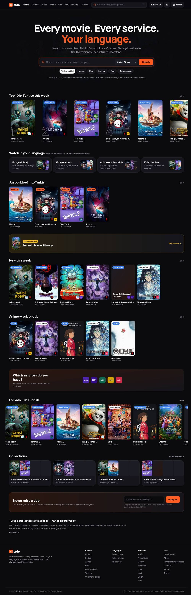
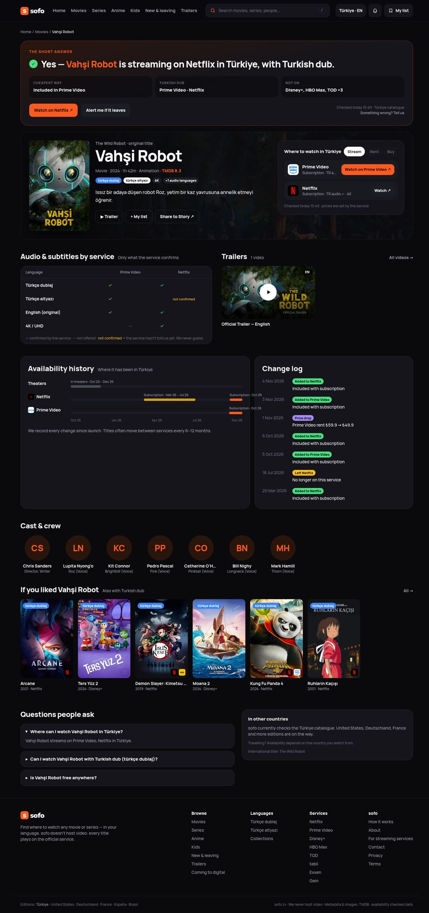
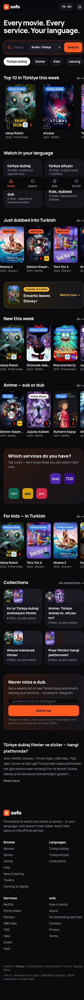
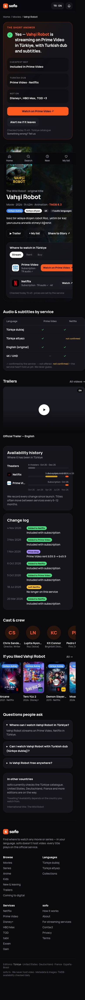

# sofo

**Every movie. Every service. Your language.**

Sofo — film yoki serialni **qaysi legal servisda**, **qaysi davlatda** va **qaysi audio/subtitr tilida** ko'rish mumkinligini ko'rsatadigan qidiruv. Birinchi bozor — Türkiye (`/tr`, "Türkçe dublaj rehberi").

- Video saqlamaymiz — faqat rasmiy servisga yo'naltiramiz. Pirat havolalar yo'q.
- Til ma'lumoti **hech qachon taxmin qilinmaydi**: `confirmed_yes` / `confirmed_no` / `unknown` → "Not confirmed by the service".
- Har bir mavjudlik yozuvida `checked_at` ko'rsatiladi; har o'zgarish tarixga yoziladi.

<p>
  
  
</p>
<p>
  
  
</p>

> Skrinshotlardagi ma'lumotlar — **namuna** (seed). Haqiqiy ma'lumot TMDB + Streaming Availability ingest orqali keladi.

**Demo:** https://site-ba9127d751304bfab1b5d5927e2fbb88.freebuff.page/tr — Freebuff Sites (production), namuna ma'lumot, `noindex`.

---

## Imkoniyatlar

| Bo'lim | URL (TR) | Nima bor |
|---|---|---|
| Bosh sahifa | `/tr` | Qidiruv, Top 10, "Just dubbed", ketayotganlar, anime/kids qatorlari, servislarim, to'plamlar, obuna |
| Film / serial | `/tr/film/{slug}`, `/tr/dizi/{slug}` | **Qisqa javob** (deterministik), Stream/Rent/Buy, audio × subtitr matritsasi, mavjudlik tarixi + change log, treylerlar, cast (fotosiz), FAQ, JSON-LD (`Movie`/`TVSeries` + `WatchAction`) |
| Sezon | `/tr/dizi/{slug}/sezon-{n}` | Qismlar, sezon darajasidagi til holati (noindex) |
| Katalog | `/tr/filmler`, `/tr/diziler`, `/tr/anime` | URL-param filtrlar (janr, servis, audio, taklif, o'n yillik, saralash), mobil bottom sheet |
| Til hublari | `/tr/turkce-dublaj`, `/tr/turkce-altyazi` | Tasdiqlangan dublaj/subtitrli nomlar, to'plamlar |
| To'plam | `/tr/turkce-dublaj/{list}` | Muharrir yozgan kirish matni, raqamlangan ro'yxat |
| Servis | `/tr/{netflix…gain}` | 8 servis: yangi, Top 10, dublajlilar, ketayotganlar, taqqoslash |
| Kids | `/tr/cocuk` | Bolalar uchun, dublajli birinchi |
| Yangi va ketayotganlar | `/tr/yeni-ve-ayrilanlar` | Haftalik kalendar, "Remind me" |
| Treylerlar | `/tr/fragmanlar` | Faqat rasmiy YouTube (nocookie, click-to-load, autoplay o'chiq) |
| Chiqish kuzatuvchisi | `/tr/yakinda-dijitalde` | Kinoteatr → raqamli → obuna → dublaj, taxmin "~" bilan |
| Franshiza | `/tr/seri/{slug}` | Chiqish / hikoya tartibi |
| Shaxs | `/tr/kisi/{slug}` | Initsiallar, filmografiya (noindex) |
| Qidiruv | `/tr/ara` | `pg_trgm` + `unaccent` ("vahsi" = "Vahşi"), autocomplete, "Did you mean", "Request this title" |
| My list | `/tr/listem` | Login'siz (localStorage), alertlar, servislarim, o'zgarishlar |
| Alertlar | — | Email/Telegram obuna, dispetcher (kuniga max 3 Telegram, juma 18:00 dayjest) |
| Admin | `/admin` | KPI, "Something wrong?" navbati (SLA 24 soat), TMDB bog'lash, to'plam muharriri, sahifa inventari |
| SEO | `/sitemap.xml`, `/robots.txt` | Sifat darvozasi: faqat indekslanadigan sahifalar; hreflang; OG/Story rasmlari `/og|story/{edition}/{movie|tv}/{slug}` |
| Huquqiy | `/tr/hakkinda`, `/tr/gizlilik` | KVKK cookie banner (rad etish — default), GA4 faqat roziligidan keyin |

## Texnologiyalar

Next.js 16 (App Router, ISR) · React 19 · TypeScript (strict) · Tailwind CSS v4 · **Cloudflare Workers (OpenNext) + D1 (SQLite) + Prisma 6** · Vitest. Hosting — Freebuff Sites. Qarorlar: [`docs/adr/0001-tech-stack.md`](docs/adr/0001-tech-stack.md), [`docs/adr/0002-cloudflare-d1.md`](docs/adr/0002-cloudflare-d1.md).

## Ishga tushirish (lokal)

Talab: **Node 20+**, **pnpm 9**. Docker kerak emas — lokal D1 (SQLite) `.wrangler/` papkasida.

```bash
pnpm install                 # bog'liqliklar + prisma generate
cp .env.example .env.local   # ixtiyoriy kalitlar (TMDB, Telegram, admin…)
pnpm db:migrate              # lokal D1 ← migrations/*.sql
pnpm db:seed                 # namuna: 36 nom, 8 servis, sezonlar, tarix, to'plamlar
pnpm dev                     # http://localhost:3000/tr
```

Workers'dagi kabi tekshirish: `sites_prepare_next` (yoki Publish) build'idan keyin `wrangler dev --config freebuff.wrangler.jsonc`.

Admin: `.env.local` ga `ADMIN_USER` / `ADMIN_PASSWORD` qo'ying (developmentda ularsiz ham ochiladi, productionda ularsiz `/admin` — 404).

## Buyruqlar

| Buyruq | Vazifasi |
|---|---|
| `pnpm dev` / `pnpm build` / `pnpm start` | Next.js |
| `pnpm lint` · `pnpm typecheck` · `pnpm test` | Tekshiruvlar (ESLint, tsc, Vitest) |
| `pnpm db:migrate` | Lokal D1 migratsiyalari (`migrations/*.sql`) |
| `pnpm db:seed` | Namuna ma'lumot lokal D1'ga (idempotent) |
| `python3 scripts/d1/build-bundle.py` | Deploy uchun migratsiya + demo to'plami (`lib/generated/d1-bundle.ts`) |
| `pnpm ingest:metadata` | TMDB → nomlar, lokalizatsiya, sezonlar, treylerlar, franshizalar |
| `pnpm ingest:availability` | Streaming Availability → offerlar, tillar, tarix (diff → event) |
| `pnpm search:bench` | 50 so'rovlik qidiruv testi (p95 < 150 ms) |
| `pnpm seo:sync-pages` | Sahifa inventari → `page` jadvali |
| `pnpm alerts:dispatch` | Alert dispetcheri (`--dry-run`, `--digest`) |

Ingest flaglari: `-- --limit=50 --dry-run --file=data/titles.csv --edition=tr`. Nomlar ro'yxati: [`data/titles.csv`](data/titles.csv).

## Muhit o'zgaruvchilari

To'liq ro'yxat — [`.env.example`](.env.example). Sirlar **faqat** `.env.local`, Vercel env yoki GitHub Actions secrets'da; repo'ga commit qilinmaydi.

| O'zgaruvchi | Kerak bo'lganda |
|---|---|
| `SETUP_TOKEN` | Deploy: `/api/setup` (migratsiya, demo) — Sites secret |
| `NEXT_PUBLIC_SITE_URL` | Canonical, sitemap, OG |
| `TMDB_API_KEY`, `STREAMING_AVAILABILITY_API_KEY` | Ingest |
| `ADMIN_USER`, `ADMIN_PASSWORD` | `/admin` (production) |
| `TELEGRAM_BOT_TOKEN`, `TELEGRAM_BOT_USERNAME`, `ALERTS_SECRET` | Alertlar |
| `NEXT_PUBLIC_GA_ID` | GA4 (faqat cookie roziligidan keyin yuklanadi) |

## Loyiha tuzilishi

```
app/                 marshrutlar: (editions)/ → "/", [lang]/ → editionlar, admin/, api/, og/, story/
components/          UI: ui/ (Poster, Chip, badges…), title/, catalog/, search/, value/, retention/, admin/
lib/                 domen: catalog, editions, short-answer, quality-gate, search, alerts/, ingest/, sources/, seo/
prisma/              schema.prisma (26 model), migrations/, seed.ts
scripts/             ingest/, seo/, alerts/, search-bench.ts
data/                titles.csv (ingest ro'yxati)
design/              dizayn ekranlari, tokenlar, boardlar (ma'lumot uchun)
docs/                PRD, data model, ADR, dizayn indeksi
prompts/             bosqichma-bosqich Claude Code promptlari (00 → 08)
```

Loyiha qoidalari va qarorlar jurnali: **[`CLAUDE.md`](CLAUDE.md)** — yagona bilim manbai.

## Holat

| Bosqich | Holat |
|---|---|
| 01 Setup | ✅ |
| 02 Asosiy sahifalar · 03 Qidiruv | ✅ |
| 04 Ingest | ✅ kod + testlar (mock) — **jonli kalitlar bilan hali yurgizilmagan** |
| 05 Qiymat funksiyalari | ✅ |
| 06 Retention | ✅ UI + dispetcher — email provayder tanlanmagan, Telegram token kerak |
| 07 Admin | ✅ |
| 08 Ishga tushirish | 🟡 Freebuff Sites production (demo) ✅ · domen, Search Console, GA, haqiqiy ingest ⏳ |

### Founder qiladigan ishlar

- [ ] TMDB API kaliti (tijoriy litsenziya — TASK-005) → `.env.local` + GitHub secrets
- [ ] Streaming Availability API kaliti (TR qamrovi — TASK-006)
- [ ] sofo.tv ni Freebuff Sites'ga ulash; `ADMIN_USER` / `ADMIN_PASSWORD` (Sites → Secrets)
- [ ] sofo.tv (+ sub-brend domenlar) ro'yxatdan o'tkazish
- [ ] Telegram bot (`@BotFather`) va email provayder
- [ ] KVKK matnlari (yurist) — `/tr/gizlilik` hozir qoralama
- [ ] TÜRKPATENT / EUIPO brend qidiruvi

## Handoff paketi

Dastlabki paket `sofo-handoff.zip` da (PRD, dizayn, promptlar) — uning mazmuni `docs/`, `design/`, `prompts/` ga yoyilgan.
